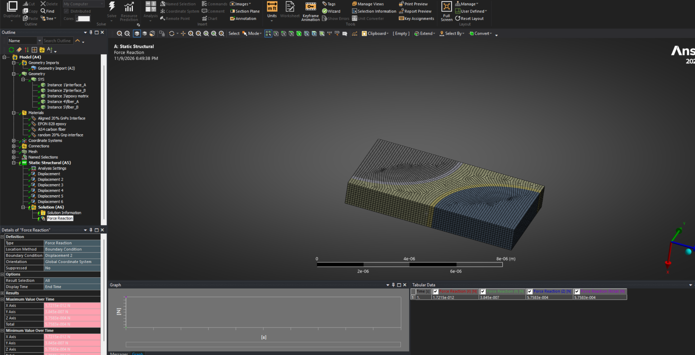
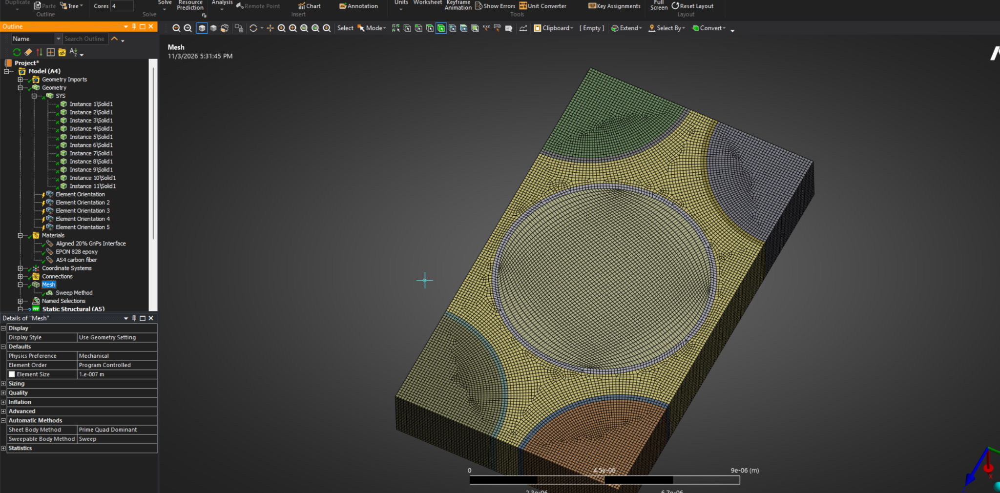
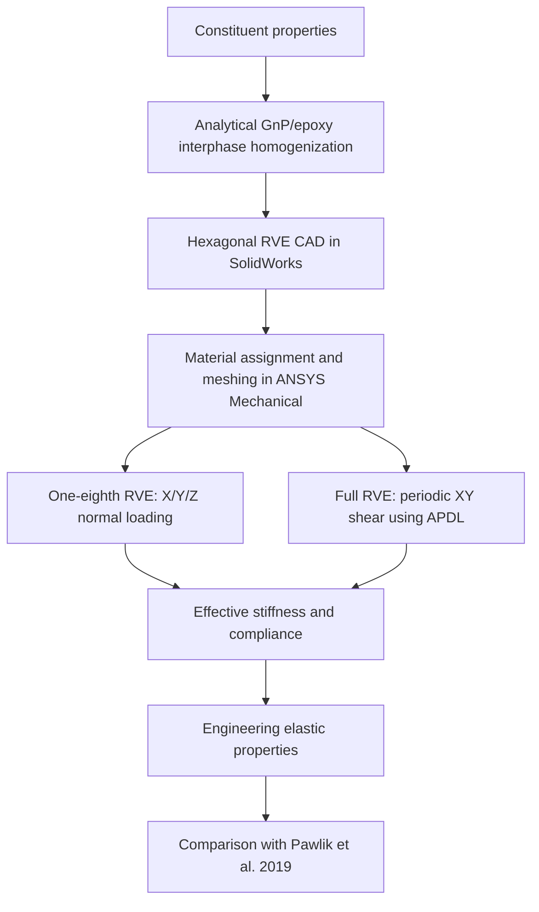

# Numerical Homogenization of GnP-Reinforced CFRP Using ANSYS

**Independent finite-element reproduction of a published multiscale study using hexagonal carbon-fibre representative volume elements (RVEs), ANSYS Mechanical, and APDL.**

## RVE models

| One-eighth RVE — symmetry-based normal loading | Full RVE — periodic shear loading |
| :---: | :---: |
|  |  |

*Original ANSYS Mechanical screenshots of the one-eighth and full RVE models.*

## Project overview

This repository documents an independent implementation of the multiscale modelling study by [Pawlik, Le and Lu (2019)](https://doi.org/10.1016/j.compositesb.2019.107097). The objective is to estimate the effective elastic properties of carbon-fibre-reinforced polymer (CFRP) with a graphene-nanoplatelet (GnP) reinforced interphase and compare the numerical results with published values.

The model represents three material regions: **carbon fibre**, **GnP-reinforced epoxy interphase**, and **epoxy matrix**. The fibre axis is the **X (longitudinal, 1-) direction**. The geometry is based on a hexagonal fibre arrangement.

The intended audience is researchers learning how to implement composite micromechanics in ANSYS, as well as engineers reviewing the modelling and verification workflow. This is an independent reproduction, not an official implementation from the original authors.

## Modelling workflow

**Interphase homogenization.** The effective GnP/epoxy interphase properties were evaluated manually using micromechanics relationships discussed in [Ji, Cao and Feng (2010)](https://doi.org/10.1088/0965-0393/18/4/045005) and Pawlik et al. (2019). For the **randomly oriented, 20% GnP interphase** case, the values used in the recorded implementation are:

| Interphase property | Value |
|---|---:|
| Young's modulus, $E_I$ | 94.080348 GPa |
| Poisson's ratio, $\nu_I$ | 0.2143153 |
| Shear modulus, $G_I$ | 38.738 GPa |
| Bulk modulus, $K_I$ | 54.886 GPa |

*The 20% GnP designation refers to the interphase formulation, not a 20% GnP fraction throughout the entire CFRP. Detailed constituent inputs and calculation notes will be included with the reproducibility documentation.*

**RVE geometry.** The one-eighth and full hexagonal RVEs were modelled separately in SolidWorks. The planned release includes editable SolidWorks part files (`.SLDPRT`) and neutral STEP exports (`.STEP`).

**Normal loading.** The **one-eighth RVE** is used for displacement-controlled normal loading along X, Y, and Z, subject to the appropriate symmetry constraints. The X-direction case will serve as the detailed worked example; the Y and Z cases follow a corresponding procedure.

**Shear loading.** The **full RVE** is used for XY shear. APDL constraint equations (`CE`) couple the displacements of corresponding nodes on periodic boundaries. The constraint implementation and its verification will be documented alongside the script.

**Property extraction.** Effective stiffness coefficients are obtained from the prescribed macroscopic deformation and the simulated response; the resulting constitutive properties are recovered using the stiffness/compliance relations. The XY shear calculation also uses total elastic strain energy.

## Validation — random 20% GnP interphase

| Effective property | This implementation | Pawlik et al. (2019) | Relative difference |
|---|---:|---:|---:|
| $E_1$ (GPa) | 156.169300 | 156.23000 | 0.04% |
| $E_2$ (GPa) | 11.156360 | 11.56000 | 3.49% |
| $\nu_{12}$ | 0.233086 | 0.23000 | 1.34% |
| $\nu_{23}$ | 0.472923 | 0.47000 | 0.62% |
| $G_{12}$ (GPa) | 6.781739 | 6.78000 | 0.03% |

The relative difference is calculated as $100|p_{\mathrm{FE}}-p_{\mathrm{ref}}|/|p_{\mathrm{ref}}|$. Values above are from the recorded project calculations and will be checked against the archived models before the final reproducibility release. The tabular data are also provided in [`results/random-20pct-validation.csv`](results/random-20pct-validation.csv).

An **aligned 20% GnP** interphase case was also analysed, but its agreement with published trends remains under review; it is **not** part of the validated comparison above.

## Repository structure and release status

| Folder | Purpose |
|---|---|
| `geometry/` | SolidWorks source geometry and STEP exports |
| `ansys-models/` | Configured ANSYS Workbench project archives (`.wbpz`) |
| `apdl-scripts/` | Periodic boundary-condition scripts and comments |
| `docs/` | Modelling, boundary-condition, and post-processing guides |
| `results/` | Numerical outputs and publication comparisons |
| `references/` | Citation information and supporting reference metadata |
| `images/` | Original model screenshots used in this README |

**Current release status:** This README, the two screenshots, and the random-case validation CSV form the initial documentation package. Geometry files, Workbench model archives, full APDL scripts, and step-by-step guides are **planned additions and are not included yet**. Any shared project files will be reviewed for university ownership and software-licensing restrictions before publication.

**Software:** SolidWorks; ANSYS Workbench / Mechanical (2026 R1, pending confirmation against the archived projects).

## References

1. Pawlik, M., Le, H., and Lu, Y. (2019). *Effects of the graphene nanoplatelets reinforced interphase on mechanical properties of carbon fibre reinforced polymer – A multiscale modelling study*. **Composites Part B: Engineering, 177**, 107097. https://doi.org/10.1016/j.compositesb.2019.107097
2. Ji, X.-Y., Cao, Y.-P., and Feng, X.-Q. (2010). *Micromechanics prediction of the effective elastic moduli of graphene sheet-reinforced polymer nanocomposites*. **Modelling and Simulation in Materials Science and Engineering, 18**. https://doi.org/10.1088/0965-0393/18/4/045005
3. Barbero, E. J. (2014). *Finite Element Analysis of Composite Materials Using ANSYS*, 2nd ed. CRC Press, **Chapter 6: Computational Micromechanics**. [Reference link](https://www.scribd.com/document/531965845/Barbero-Ever-J-Finite-Element-Analysis-of-Comp-B-ok-xyz#page=190).

*The cited publications are referenced for their theory and comparison data; their copyrighted full texts are not distributed in this repository.*
