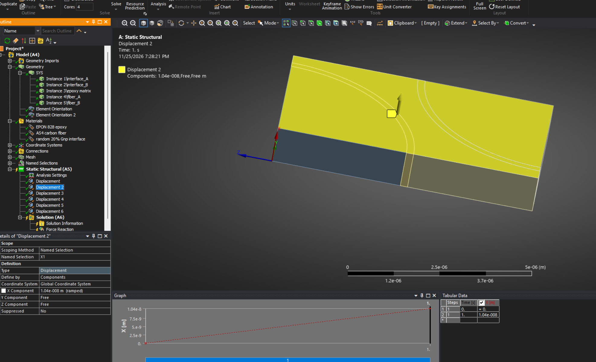
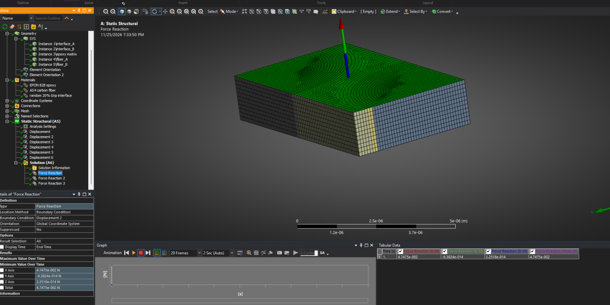
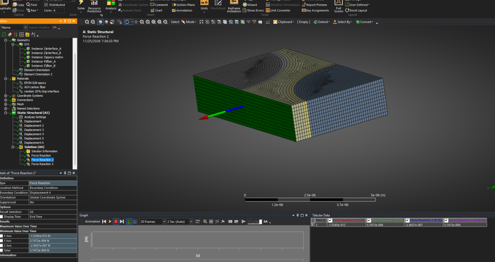
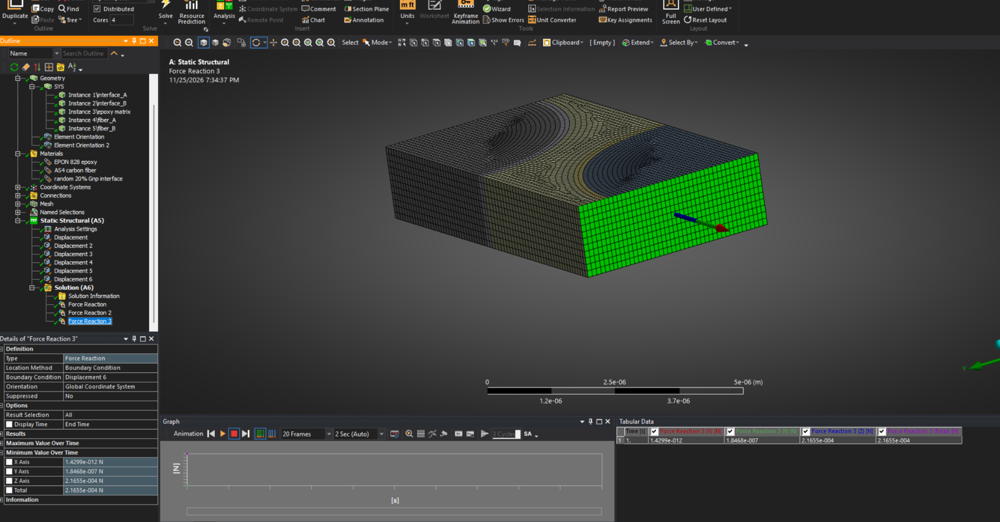

# Normal loading — one-eighth hexagonal RVE

I built a **one-eighth hexagonal CFRP RVE** in SolidWorks and used ANSYS Mechanical to calculate the effective normal stiffness coefficients of the lamina. I followed [Pawlik et al. (2019)](https://doi.org/10.1016/j.compositesb.2019.107097) for the model and [Barbero (2014), Chapter 6](../README.md#references) for the numerical homogenization approach.

## Model setup

The three material regions were AS4 carbon fibre, EPON 828 epoxy, and a homogenized **random 20 vol% GnP interphase**. I calculated the interphase inputs separately using [Hill's parameters and Mori–Tanaka homogenization](00-interphase-properties.md).

| Detail | Model value |
|---|---|
| RVE dimensions (X × Y × Z) | 1.04 × 4.16 × 7.20 µm |
| Fibre axis | Global X (material direction 1) |
| Fibre diameter; interphase thickness | 7.10 µm; 0.20 µm |
| Volume fractions | 66% fibre; 26.3% epoxy; 7.7% interphase |
| Meshing | Sweep Method; nominal element size 100 nm |
| Mesh count | 159,561 nodes; 36,454 elements |
| Material-region continuity | Shared Topology |

## Loading and stiffness calculation

I performed three displacement-controlled static structural analyses. In each, I applied a **1% macroscopic normal strain** along one coordinate direction while holding the other two macroscopic normal strains at zero.

| Case | Prescribed axial strain | Displacement magnitude |
|---|---|---|
| X | $\varepsilon_{11}=0.01$ | $u_x=0.01L_x=1.04\times10^{-8}$ m |
| Y | $\varepsilon_{22}=0.01$ | $u_y=0.01L_y=4.16\times10^{-8}$ m |
| Z | $\varepsilon_{33}=0.01$ | $u_z=0.01L_z=7.20\times10^{-8}$ m |

**X-loading example.** I prescribed $u_x$ using **Displacement 2** on named selection **X1**, with its transverse displacement components free. The ANSYS displacement-setting screenshot shows the selected face and applied $u_x=1.04\times10^{-8}$ m.

*Figure 1. Applied X displacement (1.04 × 10⁻⁸ m); Y and Z components are free.*

I extracted normal reaction forces on three relevant boundaries and calculated each normal stiffness coefficient from

$
\overline{\sigma}_{ii}=\frac{F_i}{A_i},
\qquad C_{i1}=\frac{\overline{\sigma}_{ii}}{0.01}.
$

**X reaction (Force Reaction, Displacement 2)**

*Figure 2. X-direction reaction: $F_x=0.047475$ N.*

**Y reaction (Force Reaction 2, Displacement 4)**

*Figure 3. Y-direction reaction: $F_y=3.7473\times10^{-4}$ N.*

**Z reaction (Force Reaction 3, Displacement 6)**

*Figure 4. Z-direction reaction: $F_z=2.1655\times10^{-4}$ N.*

| Reaction from ANSYS | Face area | Calculated coefficient |
|---|---|---|
| $F_x=0.047475$ N | $A_x=2.9952\times10^{-11}$ m² | $C_{11}=158.503606$ GPa |
| $F_y=3.7473\times10^{-4}$ N | $A_y=7.4880\times10^{-12}$ m² | $C_{21}=5.004407$ GPa |
| $F_z=2.1655\times10^{-4}$ N | $A_z=4.3264\times10^{-12}$ m² | $C_{31}=5.005316$ GPa |

I repeated the reaction-force procedure for Y and Z loading to complete the normal stiffness matrix $\mathbf C_N$. After calculating $\mathbf S_N=\mathbf C_N^{-1}$, I obtained $E_1=1/S_{11}$, $E_2=1/S_{22}$, $\nu_{12}=-S_{21}/S_{11}$, and $\nu_{23}=-S_{32}/S_{22}$.

I recorded the [X-direction reaction data](../results/normal-x-reaction-summary.csv) and [comparison with the published values](../results/random-20pct-validation.csv).

**Verification status:** I independently recalculated the X coefficients from rounded ANSYS readings. The detailed Y/Z reaction tables, complete face-by-face boundary-condition scopes, and mesh-convergence results are not included. The Y/Z dimension mapping used in the X-loading face-area calculation also needs confirmation against the source CAD.
